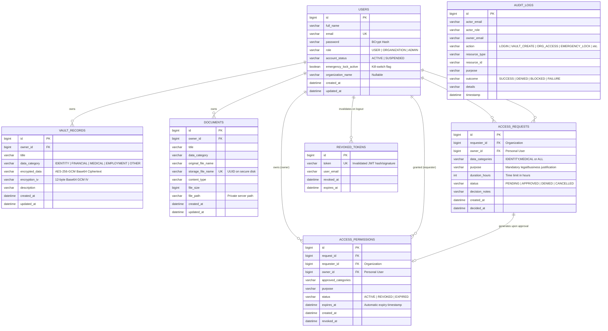

# DataVault — Entity Relationship (ER) Diagram

This diagram reflects the database schema implemented in MySQL for the **DataVault** platform.

---

## Entity Details & Security Controls

### 1. `users`
- Stores authentication credentials and platform identity.
- Passwords are encrypted with **BCrypt**.
- `emergency_lock_active`: A dedicated server-enforced flag. When set to `true`, all organization access attempts to the user's records or documents are immediately blocked with `403 Forbidden`.

### 2. `vault_records`
- Stores sensitive personal attributes (ID numbers, health metrics, credentials).
- `encrypted_data` and `encryption_iv`: Authenticated **AES-256-GCM** encryption. Plaintext is never stored in the database.

### 3. `documents`
- Stores metadata for uploaded files (scans, reports, contracts).
- Files are stored on disk using **UUID-based sanitized file paths** outside public web directories.
- Downloads are served strictly through authenticated streaming endpoints that enforce permissions and emergency lock state.

### 4. `access_requests`
- Purpose-bound request initiated by organizations.
- Contains mandatory `purpose` and finite `duration_hours`.

### 5. `access_permissions`
- Created when a user approves an access request.
- Binds access to the designated organization, owner, approved data categories, purpose, and strict `expires_at` timestamp.
- Checked dynamically on every API access request.

### 6. `revoked_tokens`
- Server-side token revocation table for stateless JWT logout.

### 7. `audit_logs`
- Append-only immutable log of every authentication, vault CRUD, file download, access attempt, approval, denial, revocation, and emergency lock toggle.
