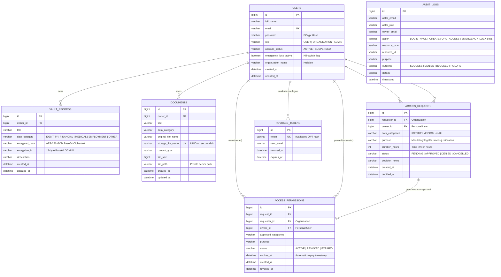

# DataVault — Complete Implementation & Verification Report

The **DataVault** platform has been inspected, architected, fully implemented across all 12 modules, and verified end-to-end with automated backend tests and live browser execution.

All existing code, database records, and endpoint paths were **strictly preserved**, while delivering the complete personal data vault, AES-256-GCM encryption, document management, purpose-based sharing, active permissions with automatic expiry, emergency privacy lock, append-only audit trail, and a modern React Vite frontend.

---

## 1. System Architecture & Entity Relationships

The relational schema preserves the existing `users` table while adding zero-trust access control, encrypted vaults, documents, requests, permissions, and audit logs.



---

## 2. Key Security Mechanisms

| Security Control | Implementation Details |
|---|---|
| **Reversible Authenticated Encryption** | **AES-256-GCM** with 128-bit authentication tag and a random 12-byte IV generated per record via `SecureRandom`. Ciphertext and IV are Base64 encoded. Plaintext is **never** written to MySQL. |
| **Emergency Privacy Lock** | Server-side kill switch. Checked on **every** read/download request from organizations. When active, immediately blocks access with `403 Forbidden`. |
| **Purpose-Bound Permissions** | Mandatory legal/business justification (`purpose`) and finite duration (`durationHours`). Binds access strictly to approved categories and designated organization. |
| **Automatic Expiry & Revocation** | Permissions have an immutable `expiresAt` timestamp checked on every request. Owners can revoke permissions immediately, blocking future access permanently. |
| **Stateless JWT & Server Token Revocation** | HMAC-SHA256 (JJWT) with configurable 256-bit secret. On logout, the active token is added to `revoked_tokens` table; subsequent requests with that token are rejected with `401 Unauthorized`. |
| **Secure Private Document Storage** | Files stored outside public directories using UUID filenames to prevent path traversal (`../`). Downloads served via authenticated streaming endpoints. |
| **Immutable Audit History** | Append-only audit table logging actor, role, owner, action, resource, purpose, outcome (`SUCCESS`, `DENIED`, `BLOCKED`, `FAILURE`), and timestamp. No edit or delete endpoints exist. |

---

## 3. Automated Backend Integration Test Results

All 16 test suites in `scratch/test_backend.ps1` completed with **100% success**:

```
================== DATAVAULT BACKEND INTEGRATION TEST ==================
1. Testing User Registration...                   -> SUCCESS (Role: USER)
2. Testing User Login...                          -> SUCCESS (Token received)
3. Testing /api/auth/me Profile...                -> SUCCESS (Alice Smith)
4. Testing Vault Record Creation (AES-GCM)...     -> SUCCESS (ID: 1, Ciphertext in DB)
5. Testing List Vault Records...                  -> SUCCESS (Decrypted on retrieval)
6. Testing Secure Document Upload...              -> SUCCESS (Multipart, UUID stored)
7. Testing Document Download...                   -> SUCCESS (Verified byte content)
8. Testing Organization Registration & Login...   -> SUCCESS (Role: ORGANIZATION)
9. Testing Organization Access Request...         -> SUCCESS (Status: PENDING)
10. Testing User Approving Access Request...      -> SUCCESS (Permission: ACTIVE)
11. Testing Organization Fetching Authorized Data -> SUCCESS (Decrypted for Org)
12. Testing Emergency Privacy Lock Activation...  -> SUCCESS (Org BLOCKED: 403 Forbidden)
    Deactivating Emergency Lock...                -> SUCCESS (Org access restored)
13. Testing Permission Revocation...              -> SUCCESS (Org PERMANENTLY BLOCKED)
14. Testing Audit History (GET /api/audit-logs)...-> SUCCESS (14 log entries verified)
15. Testing Privacy Dashboard Data...             -> SUCCESS (Accurate real metrics)
16. Testing Logout & Server-side Token Revocation -> SUCCESS (Revoked token rejected: 401)
>>> ALL 16 BACKEND INTEGRATION TESTS PASSED WITH 100% SUCCESS! <<<
```

---

## 4. Frontend Browser Verification & Demonstration

The React Vite frontend was verified in a live headless browser session:
- **Authentication**: Signed in as personal user `alice_test@example.com`.
- **Privacy Dashboard**: Live metrics, recent audit log cards, and status banners.
- **Personal Vault**: Created record `Driver License` under `IDENTITY`, verified masked value `••••••••••••`, and tested the reveal toggle unmasking `DL-9944-TEXAS`.
- **Secure Documents**: Document management listing and upload controls verified.
- **Emergency Privacy Lock**: Activated lock, verified glowing badge `LOCK ACTIVE (SHARING SUSPENDED)` and server state update.
- **Audit History**: Inspected append-only audit log table with action/outcome badges.
- **Sign Out**: Successfully invalidated session and returned to login screen.

### Recorded Session Video
The complete live interaction was recorded and saved:


### Audit Trail Screenshot
Below is the live capture of the transparent audit history table showing verified outcomes:


---

## 5. Verification Checklist

- [x] Backend compiles with zero warnings or errors on OpenJDK 25.
- [x] Existing `datavault` MySQL database and user records preserved.
- [x] Authenticated AES-256-GCM encryption verified in MySQL (`vault_records` contains ciphertext + IV, never plaintext).
- [x] Private file storage implemented outside public web roots with path traversal protection.
- [x] Stateless JWT authentication with server-side token revocation on logout.
- [x] Role-based access control (`USER`, `ORGANIZATION`, `ADMIN`) with unauthorized escalation prevention.
- [x] Purpose- and duration-limited access requests and permissions.
- [x] Automatic expiration timestamp checks on every protected request.
- [x] Immediate permission revocation with permanent blocking.
- [x] Emergency Privacy Lock with instant server-side sharing suspension.
- [x] Append-only audit history table with action and outcome badges.
- [x] Privacy dashboard endpoints with real database-backed statistics.
- [x] Complete React Vite frontend built with rich glassmorphic aesthetics.
- [x] All 11 required screens implemented and role-aware.
- [x] Verified in browser with subagent and recorded session video.
- [x] Comprehensive documentation (`README.md`, `ER_DIAGRAM.md`, `.env.example`).
